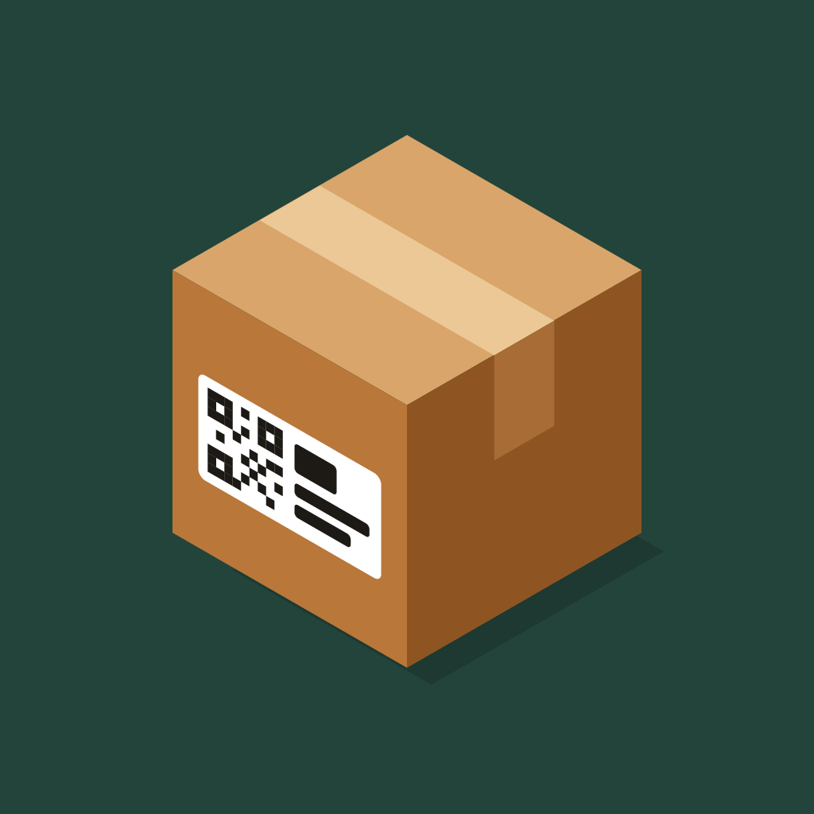

<div align="center">
  
  <h1>Box</h1>
  <p><strong>Photograph what you pack. Find it when you unpack.</strong></p>
  <p><a href="https://bx.aranlucas.workers.dev">Open the web app</a> · <a href="https://github.com/aranlucas/box/releases/latest">Download for Android</a></p>
</div>

Box turns a photo of an open moving box into a searchable inventory and a printable QR label. Pack with your household, then find the right box without opening every carton.

## From packing to unpacking

| Step           | What to do                                                                                                                            |
| -------------- | ------------------------------------------------------------------------------------------------------------------------------------- |
| **Photograph** | Tap **New box** and take a photo. Review the suggested title and item list, then assign a room.                                       |
| **Label**      | Print a numbered QR label on a **Phomemo D30** and stick it on the carton.                                                            |
| **Find**       | Search for an item, a phrase like “baking supplies,” or a box number like `#14`. Scan a label with any phone camera to open that box. |


## Set up your household

1. Open Box on the web or install the APK from [GitHub Releases](https://github.com/aranlucas/box/releases). Android may ask you to allow installs from your browser.
2. Sign in. To join an existing house, open an invite link from its owner.
3. Turn on the D30 and choose **Settings → Connect printer** in the Android app or in Chrome with Web Bluetooth.

One device can share the printer with the whole house, including iPhones running Box in Safari. Leave Box open on the connected device while it shares. Other members can choose **Print label via** that device.

Creating, searching, editing, and printing require house membership. Anyone with a box link can view that box’s contents and photos. Search ranks keyword matches first and uses OpenAI embeddings for related results. Box sends search queries, titles, rooms, and item names to OpenAI for semantic search and caches the box embeddings in D1.

## Develop locally

Use Node 24 and the pnpm version pinned in [`package.json`](package.json). Install dependencies, prepare local D1, and serve the web export from the Worker so the app and its API share an origin.

```sh
pnpm install
pnpm --filter @box/worker migrate:local
pnpm build:web
pnpm --filter @box/worker exec cf dev -- --port 8788
```

Open [http://localhost:8788](http://localhost:8788). Rebuild the web export after app changes. Put `OPENAI_API_KEY`, `AUTH_CLIENT_ID`, and `AUTH_CLIENT_SECRET` in `apps/worker/.dev.vars` when testing AI and OIDC. The local-only route `/auth/dev-login?sub=dev&name=Developer` starts a test session without OIDC. Seed the returned user as an owner of `HOME0000` in local D1 to test the inventory.

| Command                              | Runs                                                                      |
| ------------------------------------ | ------------------------------------------------------------------------- |
| `pnpm check`                         | Lint, formatting check, type checks, and unit tests                       |
| `pnpm --filter @box/app check:expo`  | Expo dependency checks and Expo Doctor                                    |
| `pnpm --filter @box/worker test:api` | HTTP integration checks with isolated local D1/R2 and a fake OIDC service |

The integration script reads `AUTH_CLIENT_ID` and `AUTH_CLIENT_SECRET` from `.dev.vars`. Local test values are sufficient for the fake issuer.

<details>
<summary>Android development and release builds</summary>

With the Worker on port 8788 and an Android emulator running:

```sh
EXPO_PUBLIC_API_URL=http://10.0.2.2:8788 pnpm --filter @box/app android
```

Build a release APK with `pnpm --filter @box/app build:android`. The APK lands at `apps/app/android/app/build/outputs/apk/release/app-release.apk`. For an ARM64-only build, set `ORG_GRADLE_PROJECT_reactNativeArchitectures=arm64-v8a`.

The native app defaults to `https://bx.aranlucas.workers.dev`. Set `EXPO_PUBLIC_API_URL` at build time to use another Worker. When testing against a local API, set `EXPO_PUBLIC_PUBLIC_ORIGIN` to a reachable public origin if you need to scan printed labels. Release APKs use the same debug signing certificate as earlier sideloadable releases.

</details>

## Project layout

| Path                               | Responsibility                                                                                         |
| ---------------------------------- | ------------------------------------------------------------------------------------------------------ |
| [`apps/app`](apps/app)             | Expo Router screens, box photos, and Bluetooth printing on Android and the web                         |
| [`apps/worker`](apps/worker)       | Hono API on Cloudflare Workers, with D1 for inventory, R2 for photos, and the Vercel AI SDK for OpenAI |
| [`packages/api`](packages/api)     | Shared API types                                                                                       |
| [`packages/label`](packages/label) | QR layout, bitmap font, D30 raster encoding, and Web Bluetooth transport                               |

See the [D30 protocol notes](docs/superpowers/specs/2026-11-18-moving-box-tracker-design.md) for the printer commands and label geometry.

<details>
<summary>Deployment and release automation</summary>

### Cloudflare Workers

The production Worker is `bx`. Its short hostname is encoded in printed labels. Cloudflare Workers Builds uses `main` and the repository root, with `pnpm check && pnpm build:web` as the build command and `pnpm --filter @box/worker exec cf deploy --no-provision` as the deploy command. Apply required D1 migrations before deploying code that uses them.

For a manual deployment, sign in to `cf` and run:

```sh
pnpm --filter @box/worker migrate
pnpm build:web
pnpm --filter @box/worker exec cf deploy --secrets-file .dev.vars
```

A single deployment can briefly mix HTML and asset requests across versions while Cloudflare updates its edge locations. To keep the current and next releases compatible during the switch, use [Cloudflare's staged rollout for static assets](https://developers.cloudflare.com/workers/versions-and-deployments/version-skew/#plan-for-related-requests):

1. Keep a copy of the live Expo export and build the next export separately.
2. Stage the live export in `apps/app/dist` and add the next export's hashed files from `_expo/` and `assets/`. Keep the live `index.html` and deploy with `pnpm --filter @box/worker exec cf deploy --no-provision`.
3. Allow that deployment to propagate, then stage the next export in `apps/app/dist`, keeping the live release's hashed files alongside it. Deploy again with the same command. Use this overlapping build for rollbacks while pages from both releases may be open.

Treat these as two separate deployments. The default Workers Builds command runs a single deployment per push, so run the staged releases separately from automatic builds.

For your own deployment, create a D1 database and R2 bucket. Update [`cloudflare.config.ts`](apps/worker/cloudflare.config.ts) with your Worker and bindings, and point the migration scripts at your D1 database. Set your public origin in the Worker and native app, configure the OIDC issuer and callback, and provision the three runtime secrets.

After the first sign-in, seed the first owner in D1 by inserting a row into `members` with `house_id='HOME0000'`, the signed-in account’s `users.id` as `user_id`, `role='owner'`, and the current Unix time in milliseconds as `created_at`.

### CI and releases

[CI](.github/workflows/ci.yml) runs the workspace checks, exports the web app, and builds an ARM64 Android APK. Use [Conventional Commits](https://www.conventionalcommits.org/) for PR titles because the squash commit drives [Release Please](https://github.com/googleapis/release-please). An app feature or fix starts a release PR that updates the app version, Android version code, and changelog. Merging that PR tags the release and attaches `box-vX.Y.Z-arm64.apk`.

</details>
